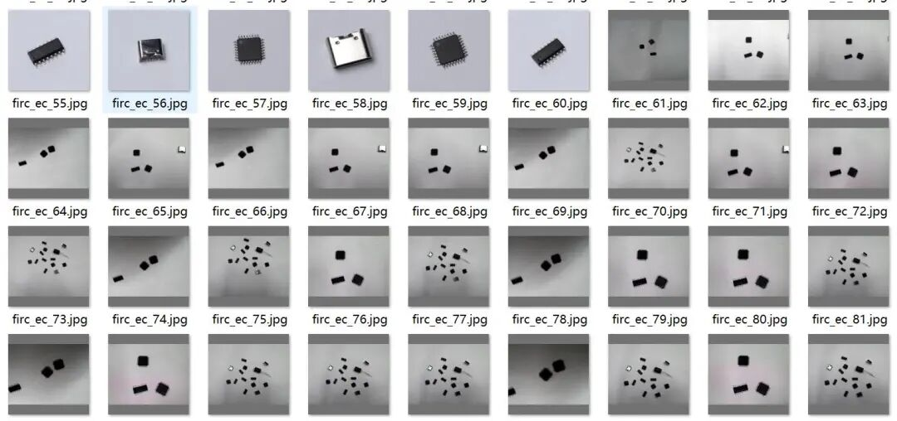
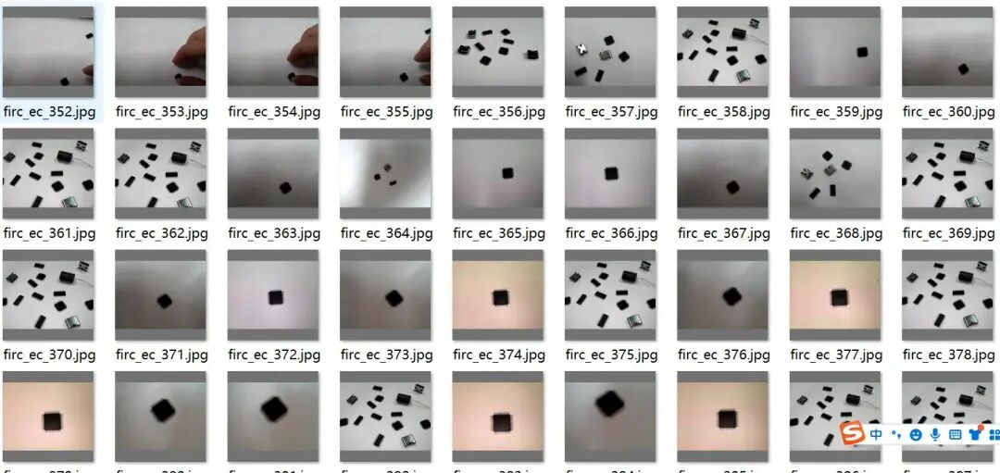
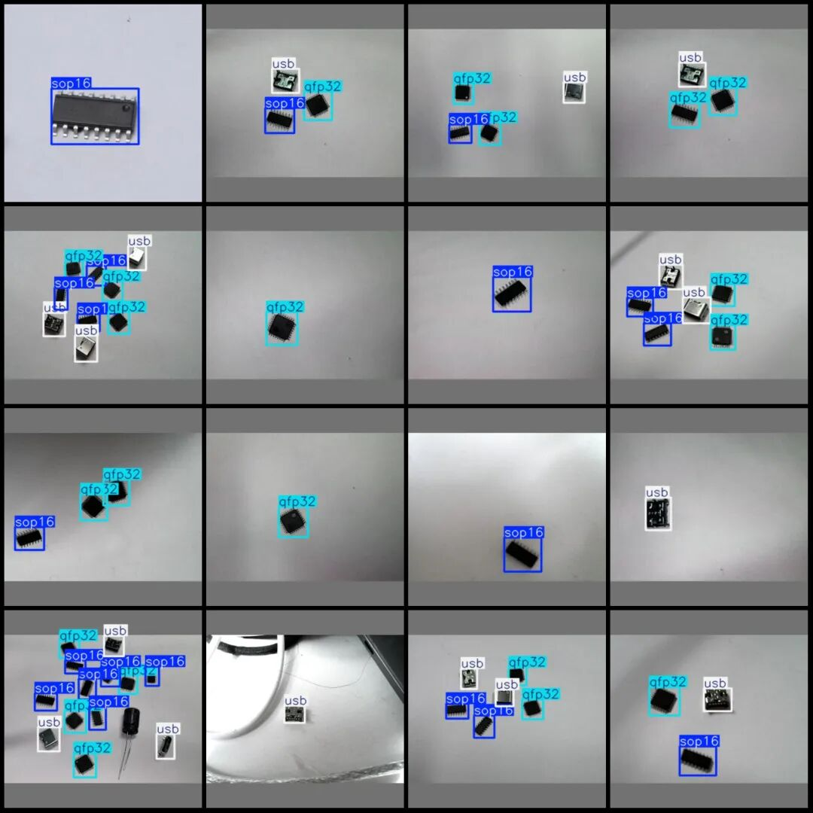
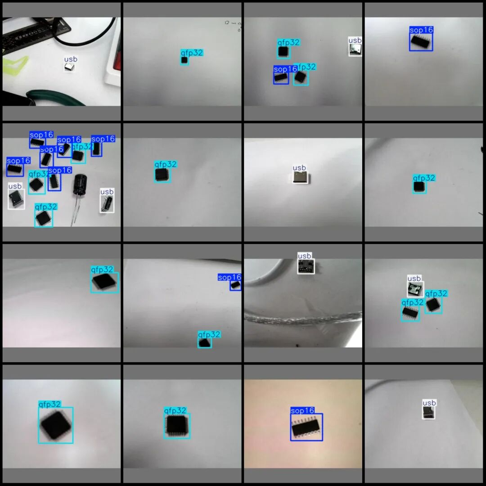

# Electronic Chip Type Identification and Detection Dataset VOC+YOLO format with 1226 images in 3 categories

Dataset format: Pascal VOC format + YOLO format (txt file without split path, only containing jpg images and corresponding VOC format xml files and yolo format txt files)

Number of images (number of jpg files): 1266

Number of annotations (number of xml files): 1266

Number of annotations (number of txt files): 1266

Label category count: 3

Label category names (note that the order of yolo format categories does not correspond to this, but is based on the labels folder's classes.txt): ["qfp32", "sop16", "usb"]

Number of boxes labeled in each category:

qfp32 (32-pin square flat package) count = 1287

sop16 (16-pin small-package) Frame Count = 1371

USB (USB interface) frame count = 1010

Total frame count: 3668

Image resolution: 320x320

Using labelImg:

Annotation rules: Draw a rectangle around the category.

Important Notice: No

Special : This dataset does not guarantee the accuracy of the trained models or weight files.

Image Preview:

Annotation example:

## Payment

Here is a pay link on Stripe ( https://buy.stripe.com/3cs8yP7sY87d0vu9AB ). Please contact me lonlonago@foxmail.com after funding $89, and I will send you a complete data files , thank you!

